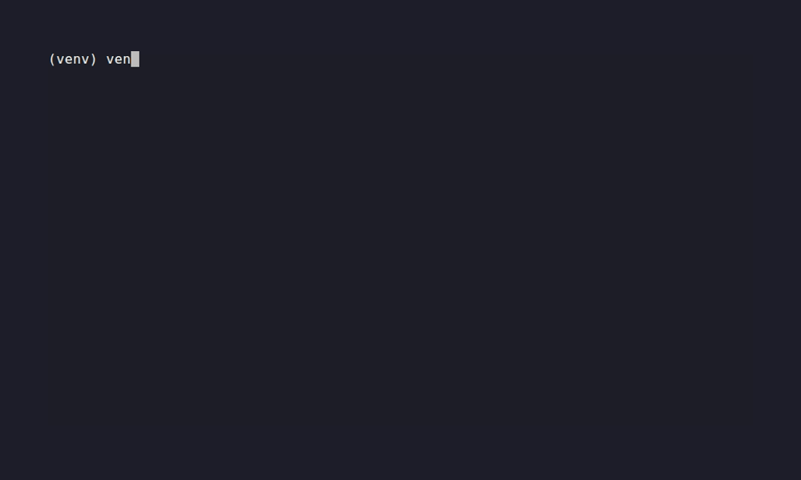

# ICS Agentic SOC Pipeline

**ML anomaly detection → RAG enrichment → LLM agent (NIST reports + Suricata rules).**

I built this pipeline to demonstrate how a Level 1 SOC Analyst can be automated for OT/ICS environments using ML anomaly detection, RAG-augmented knowledge retrieval, and a LangChain agent. It ingests synthetic telemetry modelled on the [OT-Security-Lab](https://github.com/LiamCarPer/ot-security-lab) water treatment simulation, detects operational anomalies, retrieves relevant OT context, and generates NIST SP 800-61 incident reports with Suricata detection rules. The pipeline drafts; a human reviews before anything is deployed.

> **Why?** ICS security teams are understaffed and OT alerts are high-noise. This system shows that agentic AI can assist with Level 1 triage, produce analyst-style reports, and draft detection content in seconds.

[](https://github.com/LiamCarPer/ics-agentic-soc-pipeline/actions/workflows/test.yml)
[](LICENSE)



---

## Architecture

```
Telemetry CSV → detect_anomalies.py → alerts.jsonl
                                            ↓
                                     POST /alert → webhook_receiver.py
                                            ↓
                                     src/rag.py (ChromaDB enrichment)
                                            ↓
                                     agent.py (LangChain + GPT-4o-mini)
                                            ↓
                              outputs/incident_*.md  +  block_*.rules
```

(Full ASCII diagram in [`docs/ARCHITECTURE.md`](docs/ARCHITECTURE.md).)

---

## Quick Start

### Prerequisites

- Python 3.11+
- An OpenAI API key (or [OpenRouter](https://openrouter.ai) key)

### Setup

Choose one:

**Local (venv):**
```bash
git clone https://github.com/LiamCarPer/ics-agentic-soc-pipeline.git
cd ics-agentic-soc-pipeline
python -m venv venv
source venv/bin/activate
pip install -r requirements.txt
```

**Docker:**
```bash
git clone https://github.com/LiamCarPer/ics-agentic-soc-pipeline.git
cd ics-agentic-soc-pipeline
docker compose up -d
```

### Environment

```bash
# .env (copy from .env.example)
cp .env.example .env
# Then edit .env with your API key
OPENAI_API_KEY=sk-...
# Optional: for OpenRouter or Ollama
OPENAI_BASE_URL=https://openrouter.ai/api/v1
```

> **Security:** `.env` is in `.gitignore`. Never commit your real API key. The repo ships with no keys baked in — all tests are deterministic and don't need an API key.

### Ingest Knowledge

```bash
python scripts/ingest_rag.py --reset
```

### Start the Webhook Receiver

```bash
uvicorn scripts.webhook_receiver:app --host 127.0.0.1 --port 8000
```

If `WEBHOOK_API_KEY` is set, send `X-API-Key: <value>` with requests. Use
`POST /alert/async` for a 202 + background task and poll `GET /alerts/{id}`.

### Send an Alert

```bash
curl -X POST http://localhost:8000/alert \
  -H "Content-Type: application/json" \
  -H "X-API-Key: ${WEBHOOK_API_KEY:-}" \
  -d @sample_alert.json
```

The receiver logs `PUBLISH alert_id=...`, runs the agent (sync) or queues it
(async), and returns the incident report summary and Suricata rule path.

### Outputs

| File | Contents |
|------|----------|
| `outputs/incident_*.md` | NIST SP 800-61 incident report with affected assets, observed activity, impact assessment, and RAG citations |
| `outputs/block_*.rules` | Alert-only Suricata rule targeting the specific Modbus pattern (FC 6/16 writes, FC 131 scans, anomalous reads) |
| `outputs/audit/agent_runs.jsonl` | Structured audit record: prompt/RAG/tool/output hashes, latency, status |

### Apply the Suricata Rule

Generated rules are staged, not deployed. Review the rule and validate it with
your Suricata configuration before any network change.

```bash
# After review, validate and deploy (example):
suricata -T -S outputs/block_e8358fb5-*.rules -c /etc/suricata/suricata.yaml
suricata -S outputs/block_e8358fb5-*.rules -i eth0
# Or merge into your local rules after review:
cat outputs/block_*.rules >> /etc/suricata/rules/local.rules
```

---

## Components

### 1. Detection Service

Train and run the anomaly detection model:

```bash
# Generate telemetry
python scripts/generate_telemetry.py

# Detect anomalies
python scripts/detect_anomalies.py \
  --input data/test/telemetry.csv \
  --output data/alerts.jsonl \
  --model models/isolation_forest.joblib \
  --scaler models/scaler.joblib \
  --threshold -0.03
```

### 2. RAG Ingestion

Ingest OT knowledge into ChromaDB (asset inventory, IEC 62443 controls, past incidents):

```bash
python scripts/ingest_rag.py --reset
```

### 3. Webhook Receiver

FastAPI server that receives alerts and triggers the agent:

```bash
uvicorn scripts.webhook_receiver:app --host 0.0.0.0 --port 8000
```

### 4. Agent

Run the agent standalone on a single alert:

```bash
python scripts/agent.py --alert sample_alert.json
```

Add `--dry-run` to write artifacts under `outputs/staging/<run_id>/`, or
`--local-only` to reject non-local LLM endpoints.

---

## Tests

All tests are deterministic — no API key, no live ChromaDB, no network required.

```bash
python -m pytest tests/ -v
```

The test suite covers:

| Test file | Tests | What it proves |
|-----------|-------|----------------|
| `tests/test_rag.py` | 11 | Anomaly classification (7 branches), query building (2), ChromaDB mocked retrieval (2) |
| `tests/test_agent.py` | 14 | SID generation (3), rule validation (4), anomaly analysis logic (7) |
| `tests/test_webhook.py` | 12 | Sync/async endpoints, validation, auth, rate limiting, health |
| `tests/test_security_*.py` | 81 | Strict schemas, path confinement, prompt sanitisation, tool context, artifact integrity, audit logging, egress policy, red-team cases |

That's **118 tests total**.

The ML path is still not fully unit-tested: add tests for feature values, window
counts and alert construction before changing the detector.

---

## Security

This is a **hardened lab prototype**, not a production SOC product. The security
work is documented in [`SECURITY.md`](SECURITY.md) and
[`docs/AI_SECURITY.md`](docs/AI_SECURITY.md); the model's limits and security
evaluation are in [`docs/MODEL_CARD.md`](docs/MODEL_CARD.md).

Implemented controls include:

- strict alert schemas (UUID, IP, function-code allowlist, bounds, no extra fields);
- output path confinement and UUID-derived filenames;
- untrusted-data prompt delimiters, with tools reading validated run context by
  `alert_id` rather than trusting the LLM;
- alert-only Suricata rule guard (no `drop`/`reject`) and managed SID range;
- SHA-256 manifests for the model, scaler and knowledge-base documents, verified
  before load/ingest;
- structured JSONL audit logs with secret redaction;
- webhook API key, rate limit and body-size cap, plus accurate 200/202 semantics;
- LLM provider allowlist and local-only mode.

Verify it yourself:

```bash
python scripts/verify_artifacts.py
python scripts/redteam_agent.py
python security/evals/evasion_experiment.py
python security/evals/poisoning_experiment.py
```

The red-team suite assumes the LLM can be compromised and attacks the capability
boundary. The ML evaluations show the detector is effectively a tank-level model:
overfill is missed, slow scans evade, and 5–10% training-data poisoning collapses
recall. Those limits are the point of the security documentation, not something
the repo hides.

Generated rules are `alert`-only and staged. **Nothing in this repository
auto-deploys a rule or writes to a PLC.**

---

## Tooling

This project uses modern Python tooling:

| Tool | Purpose |
|------|---------|
| [Ruff](https://docs.astral.sh/ruff/) | Linter and formatter (CI-gated, pinned to v0.11.0) |
| [pre-commit](https://pre-commit.com/) | Git hooks — Ruff, detect-secrets, hygiene |
| [Bandit](https://bandit.readthedocs.io/) | Static security analysis (medium+ in CI) |
| [detect-secrets](https://github.com/Yelp/detect-secrets) | Secret scanning with a committed baseline |
| [pip-audit](https://pypi.org/project/pip-audit/) | Dependency advisory report (non-blocking CI job) |

```bash
pip install -r requirements-dev.txt
pre-commit install
pre-commit run --all-files
```

---

## Documentation

| Doc | Description |
|-----|-------------|
| [`docs/PRD.md`](docs/PRD.md) | Full product requirements document — problem statement, vision, roadmap, success metrics |
| [`docs/ARCHITECTURE.md`](docs/ARCHITECTURE.md) | System architecture diagram and data flow |
| [`docs/ANOMALY_DEFINITIONS.md`](docs/ANOMALY_DEFINITIONS.md) | Plain-language anomaly specifications with MITRE ATT&CK for ICS mappings |
| [`docs/FEATURE_ENGINEERING.md`](docs/FEATURE_ENGINEERING.md) | Feature design — windowing, scaling, Iteration 2 results, physics rationale |
| [`docs/AGENT_DESIGN.md`](docs/AGENT_DESIGN.md) | Agent framework choice, tool design, prompt strategy, LLM selection |
| [`docs/AI_SECURITY.md`](docs/AI_SECURITY.md) | AI threat model, OWASP/ATLAS/NIST mapping, controls, residual risks |
| [`docs/MODEL_CARD.md`](docs/MODEL_CARD.md) | Model provenance, per-class metrics, security evaluation, limitations |
| [`SECURITY.md`](SECURITY.md) | Reporting, security posture, secrets, known limitations |

---

## CI/CD

This repository uses GitHub Actions for continuous integration. On every push or
pull request to `main`:

1. **`test.yml`** sets up Python 3.11, installs runtime dependencies, runs the
   pinned pre-commit hooks (Ruff, detect-secrets), and runs the full test suite.
2. **`security.yml`** verifies model/RAG artifact manifests, runs the AI red-team
   suite, runs the evasion and poisoning evaluations, runs Bandit, scans for
   secrets, and runs a non-blocking dependency audit + dependency review.

No live services, no API keys, no GPU required in CI.
